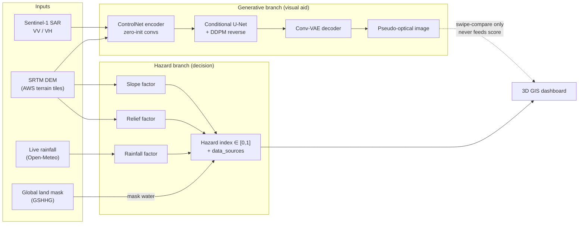
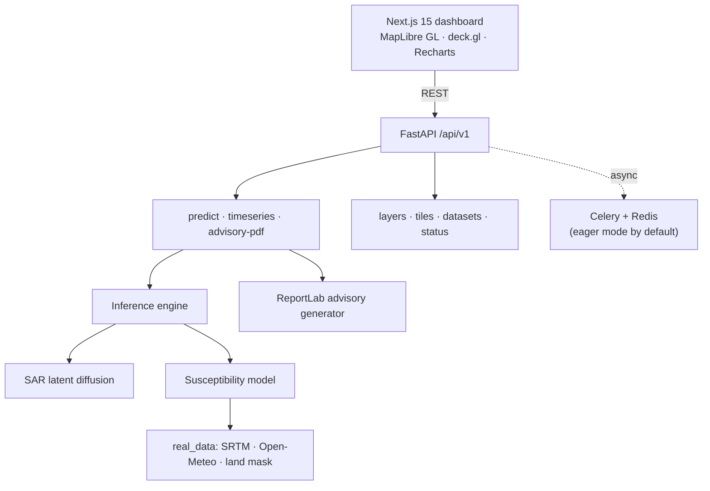

<div align="center">

# SAR-Landslide-GenAI

### A Generative AI Framework for Cloud-Free SAR-to-Optical Synthesis and Explainable Landslide Susceptibility Mapping in the Western Ghats

**Johan S Varughese** · **Aiswarya M S** · **Nadeema Jahan** · **Rishika Pratap Jagdale**

[](#reproducibility)
[](backend/)
[](backend/app/models/sar_diffusion.py)
[](frontend/)
[](#data-sources)
[](#limitations-and-honest-scope)

[Abstract](#abstract) · [Method](#method) · [Architecture](#system-architecture) · [Reproducibility](#reproducibility) · [API](#api-reference) · [Limitations](#limitations-and-honest-scope) · [Citation](#citation)

</div>

---

## Authors

This repository is the project of:

| Author | Register No. |
|---|---|
| **Johan S Varughese** | B23CS2135 |
| **Aiswarya M S** | B23CS2111 |
| **Nadeema Jahan** | B23CS2146 |
| **Rishika Pratap Jagdale** | B23CS2155 |

All design, implementation, and write-up in this repository is the work of the four authors listed above.

---

## TL;DR

> Optical satellites go blind during the monsoon, exactly when landslides happen. SAR sees through cloud but is hard to read.
> **SAR-Landslide-GenAI** pairs a ControlNet-style **conditional latent diffusion** model (SAR + DEM → pseudo-optical imagery) with a **transparent, provenance-aware susceptibility model** built on real terrain and live rainfall, and serves both through an interactive 3D GIS decision-support dashboard.

<table>
<tr>
<td width="33%" valign="top">

**All-weather imaging**
Dual-pol (VV/VH) Sentinel-1 + DEM conditioning for cloud-free pseudo-optical synthesis.

</td>
<td width="33%" valign="top">

**Explainable hazard**
Fixed-weight overlay of real slope, live rainfall, and terrain relief. Every number is traceable.

</td>
<td width="33%" valign="top">

**Provenance by design**
Each prediction reports its data sources; synthetic fallbacks are labelled, never hidden.

</td>
</tr>
</table>

---

## Abstract

Rainfall-induced landslides are among the most destructive natural hazards in the Western Ghats of Kerala, India, as the 2018 monsoon floods and the 2024 Wayanad disaster demonstrated. Satellite remote sensing is essential for monitoring such vast and inaccessible terrain, yet optical sensors fail during the monsoon because dense cloud cover obscures the ground precisely when landslide activity peaks. Synthetic aperture radar (SAR) penetrates cloud and operates day and night, but its speckled backscatter imagery is difficult for disaster managers and the public to interpret.

We present **SAR-Landslide-GenAI**, an end-to-end framework that combines generative AI with physically grounded geospatial analysis to provide all-weather, interpretable, and transparent landslide hazard assessment. The generative core is a **ControlNet-style conditional latent diffusion model** that translates dual-polarisation Sentinel-1 backscatter, together with a digital elevation model, into cloud-free pseudo-optical imagery. Hazard estimation is deliberately performed by a separate, **interpretable susceptibility model**: a per-pixel weighted overlay of SRTM-derived slope, live accumulated rainfall from Open-Meteo, and local terrain relief, with a global land mask removing open water from scoring. Every prediction reports the provenance of its inputs.

The framework is delivered as a full-stack decision-support system: a FastAPI backend with asynchronous task processing, and a Next.js dashboard built on MapLibre GL and deck.gl with SAR/optical swipe-comparison, monsoon-season trend analytics, and auto-generated citizen advisory PDFs.

**Index Terms:** conditional latent diffusion, ControlNet, explainable hazard assessment, generative AI, landslide susceptibility mapping, SAR-to-optical translation, Sentinel-1, Western Ghats.

---

## Contributions

1. **A cloud-penetrating generative imaging pipeline.** A from-scratch PyTorch implementation of a conditional latent diffusion model (conv-VAE + zero-initialised ControlNet condition encoder + timestep-conditioned U-Net + DDPM reverse process) for SAR + DEM → pseudo-optical translation.
2. **An explainable, provenance-aware hazard model.** A transparent weighted-overlay susceptibility model over *real* inputs, in the same methodological family as GSI macro-scale Landslide Hazard Zonation and Anbalagan-style overlays, with water masking and explicit "Not Applicable" outputs.
3. **Decoupling of generation from decision.** The generative model is architecturally separated from the hazard score, so an imperfect image generator can never corrupt a safety-relevant number.
4. **A reproducible decision-support system.** Open API, typed schemas, test suite, data preprocessing pipeline, and a 3D GIS dashboard aimed at disaster-management workflows.

---

## Method



### 1. Conditional latent diffusion for SAR → optical synthesis

Implemented in [`backend/app/models/sar_diffusion.py`](backend/app/models/sar_diffusion.py):

| Component | Role |
|---|---|
| `LatentAutoencoder` | Convolutional VAE compressing RGB imagery into a compact latent space (reparameterised Gaussian). |
| `ControlNetEncoder` | Encodes the SAR (VV, VH) + DEM condition stack; **zero-initialised output convolutions** inject conditioning without destabilising the denoiser at the start of training. |
| `ConditionalUNet` | Noise-prediction network with **sinusoidal timestep embeddings**, conditioned on ControlNet features. |
| `DDPMSchedule` | Linear β schedule (T = 1000, β ∈ [1e-4, 2e-2]) driving the ancestral DDPM reverse process. |
| `AnomalyDetector` | Local-SSIM-based change map between SAR-derived and synthesised views. |

The forward and reverse processes follow Ho et al. (2020):

$$
q(x_t \mid x_0) = \mathcal{N}\!\left(\sqrt{\bar\alpha_t}\,x_0,\;(1-\bar\alpha_t)\mathbf{I}\right),
\qquad
x_{t-1} = \frac{1}{\sqrt{\alpha_t}}\left(x_t - \frac{\beta_t}{\sqrt{1-\bar\alpha_t}}\,\epsilon_\theta(x_t, t, c)\right) + \sigma_t z
$$

where $c = \mathrm{ControlNet}(\mathrm{VV}, \mathrm{VH}, \mathrm{DEM})$.

### 2. Explainable susceptibility model

Implemented in [`backend/app/services/susceptibility.py`](backend/app/services/susceptibility.py). For each pixel $p$:

$$
H(p) = \underbrace{0.45\,f_{\text{slope}}(p)}_{\text{static susceptibility}} + \underbrace{0.40\,f_{\text{rain}}}_{\text{trigger}} + \underbrace{0.15\,f_{\text{relief}}(p)}_{\text{dissection}},
\qquad H(p) = 0 \;\;\text{if } p \in \text{water}
$$

| Factor | Source | Normalisation |
|---|---|---|
| $f_{\text{slope}}$ | Real SRTM-derived slope (AWS terrain tiles) | against a 40° critical-slope reference |
| $f_{\text{rain}}$ | Accumulated precipitation over the requested window (Open-Meteo) | against a 300 mm monsoon-extreme reference |
| $f_{\text{relief}}$ | Local elevation std-dev, $\sqrt{\mathbb{E}[X^2]-\mathbb{E}[X]^2}$ over a 5×5 window | against a 60 m reference |
| water mask | `global-land-mask` (offline, GSHHG-derived) | water-dominant tiles → `risk_level: "Not Applicable"` |

### 3. Provenance and graceful degradation

Every response carries a `data_sources` block (elevation / rainfall origin, real vs. fallback) and an `is_water_dominant` flag. All heavy dependencies (`torch`, `rasterio`, `geopandas`, `asf_search`, `global-land-mask`) are imported defensively: if a package or live source is unavailable, the affected feature degrades to a **clearly labelled** synthetic fallback rather than crashing or silently presenting fabricated data as real.

---

## System Architecture



```
.
├── backend/                         FastAPI + PyTorch service
│   ├── app/
│   │   ├── main.py                  application entry point
│   │   ├── api/v1/endpoints/        predict, status, datasets, tile_server
│   │   ├── core/                    config, security, GIS utilities, Celery app
│   │   ├── models/sar_diffusion.py  conditional latent diffusion (VAE + ControlNet + U-Net + DDPM)
│   │   ├── services/                real_data, susceptibility, inference_engine,
│   │   │                            band_processor, pdf_report, tasks
│   │   ├── schemas/hazard.py        typed request / response models
│   │   └── data/kerala_zones.geojson  Western Ghats vulnerability layer
│   ├── scripts/preprocess.py        tile + normalise raw GeoTIFFs into training stacks
│   └── tests/test_api.py            API test suite
├── frontend/                        Next.js 15 (App Router, React 19, TypeScript) dashboard
├── diffusion-explainer/             companion project: step-by-step DDPM/DDIM visual explainer
├── data/{raw,processed}/            dataset storage (contents git-ignored)
├── SAR_Landslide_GenAI_*_IEEE.docx  IEEE-format abstracts
└── run.sh / run.ps1                 launch backend + frontend together
```

### Dashboard capabilities

- 3D hazard grid on MapLibre GL + deck.gl, with optional MapTiler terrain-DEM tiles
- **Swipe-compare** between SAR backscatter and synthesised optical view
- Monsoon-season (May–Sep) trends for risk, soil moisture, and rainfall
- One-click **citizen advisory PDF** generation
- Static Western Ghats vulnerability overlay (Idukki, Wayanad, and surrounding zones)

---

## Companion Project: *Diffusion, Traced*

[`diffusion-explainer/`](diffusion-explainer/) is a self-contained teaching tool that runs the exact forward-noising and reverse-denoising mathematics of DDPM / DDIM (linear and cosine schedules, classifier-free guidance) on an uploaded image and visualises every step with live-substituted equations and telemetry charts. It documents the diffusion theory underlying the main framework. See its own [README](diffusion-explainer/README.md).

---

## Data Sources

| Dataset | Use | Link |
|---|---|---|
| Sentinel-1 GRD IW (NASA ASF) | SAR backscatter over Idukki (9.85°N, 76.97°E) and Wayanad (11.69°N, 76.13°E) | [asf.alaska.edu](https://asf.alaska.edu/) |
| Zenodo Landslide Reference Data | Paired Sentinel-1 / Sentinel-2 samples for supervised training | [zenodo.org/records/15421843](https://zenodo.org/records/15421843) |
| GLaD4CD | Landslide change-detection patches | [zenodo.org/records/14226448](https://zenodo.org/records/14226448) |
| SRTM via AWS Terrain Tiles | Elevation, slope, relief | [registry.opendata.aws/terrain-tiles](https://registry.opendata.aws/terrain-tiles/) |
| Open-Meteo | Live and historical precipitation | [open-meteo.com](https://open-meteo.com/) |
| `global-land-mask` (GSHHG) | Offline land / water masking | [PyPI](https://pypi.org/project/global-land-mask/) |

Raw and processed rasters are **not** committed. Place GeoTIFFs in `data/raw/` and run `backend/scripts/preprocess.py`. Set `ASF_USERNAME` / `ASF_PASSWORD` in `backend/.env` from [NASA Earthdata Login](https://urs.earthdata.nasa.gov/) to download Sentinel-1 granules.

---

## Reproducibility

### Requirements

- Python 3.11+, Node.js 20+
- Optional: Redis (for non-eager Celery), CUDA GPU (CPU works)

### 1. Backend

```bash
cd backend
python -m venv .venv
.venv/bin/pip install -r requirements.txt          # Windows: .venv\Scripts\pip install -r requirements.txt
cp .env.example .env                                # optional; defaults work out of the box
```

### 2. Frontend

```bash
cd frontend
npm install
cp .env.local.example .env.local                    # optional; defaults to http://localhost:8000
```

### 3. Run

```bash
./run.sh        # macOS / Linux / Git Bash
.\run.ps1       # Windows PowerShell
```

| Service | URL |
|---|---|
| Backend API | http://localhost:8000 (OpenAPI docs at `/docs`) |
| Dashboard | http://localhost:3000/dashboard |

### 4. Tests

```bash
cd backend
.venv/bin/pytest                                    # Windows: .venv\Scripts\pytest
```

---

## API Reference

| Method | Path | Description |
|---|---|---|
| `POST` | `/api/v1/predict/landslide` | SAR→optical synthesis + hazard scoring for a zone / bbox and date range |
| `POST` | `/api/v1/predict/landslide/async` | Same, dispatched as a background task |
| `GET` | `/api/v1/predict/task/{task_id}` | Poll an async prediction |
| `GET` | `/api/v1/predict/timeseries` | Monsoon-season risk / soil-moisture / rainfall trend |
| `POST` | `/api/v1/predict/advisory-pdf` | Generate a downloadable citizen advisory PDF |
| `GET` | `/api/v1/layers/kerala-zones` | Western Ghats vulnerability GeoJSON |
| `GET` | `/api/v1/tiles/processed/{filename}` | Fetch a synthesised GeoTIFF artefact |
| `GET` | `/api/v1/status` | Model / satellite / monsoon status |
| `GET` | `/api/v1/datasets` | Inventory of raw and processed files on disk |

Illustrative response excerpt (values abbreviated):

```json
{
  "risk_level": "High",
  "mean_hazard_index": 0.71,
  "max_hazard_index": 0.93,
  "rainfall_total_mm": 214.6,
  "is_water_dominant": false,
  "data_sources": {
    "elevation": "SRTM (AWS terrain tiles)",
    "rainfall": "Open-Meteo",
    "water_mask": "global-land-mask (GSHHG coastline, offline)",
    "sar": "..."
  }
}
```

---

## Limitations and Honest Scope

We consider it a research obligation to state clearly what this system is **not**:

| Aspect | Current status |
|---|---|
| Diffusion model weights | Architecture is complete; weights are **not yet trained**. Synthesised imagery is illustrative and **never feeds the hazard score**. |
| Susceptibility weights | Fixed, literature-motivated (0.45 / 0.40 / 0.15); **not yet calibrated** against a historical landslide inventory. |
| Rainfall normalisation | 300 mm reference is tuned for the Western Ghats; applying it to other climates is a known limitation. |
| Operational use | Research-grade decision support only. **Not** a replacement for official KSDMA / IMD alerts. |

---

## Roadmap

- [ ] Train the conditional diffusion model on the assembled Sentinel-1 / Sentinel-2 paired dataset
- [ ] Evaluate synthesis quality with SSIM, PSNR, and FID
- [ ] Calibrate susceptibility weights against historical landslide inventories (2018, 2019, 2024 events)
- [ ] Validate with geotechnical experts; report ROC-AUC against held-out inventory
- [ ] Add InSAR coherence and soil-moisture products as additional factors

---

## Citation

If you use this work, please cite:

```bibtex
@misc{varughese2026sarlandslidegenai,
  title  = {SAR-Landslide-GenAI: A Generative AI Framework for Cloud-Free SAR-to-Optical
            Synthesis and Explainable Landslide Susceptibility Mapping in the Western Ghats},
  author = {Varughese, Johan S and M S, Aiswarya and Jahan, Nadeema and Jagdale, Rishika Pratap},
  year   = {2026},
  note   = {Project repository},
  url    = {https://github.com/jo-sh-varughese/SAR-Landslide-GenAI}
}
```

## References

1. J. Ho, A. Jain, P. Abbeel, "Denoising Diffusion Probabilistic Models," *NeurIPS*, 2020.
2. R. Rombach *et al.*, "High-Resolution Image Synthesis with Latent Diffusion Models," *CVPR*, 2022.
3. L. Zhang, A. Rao, M. Agrawala, "Adding Conditional Control to Text-to-Image Diffusion Models (ControlNet)," *ICCV*, 2023.
4. J. Song, C. Meng, S. Ermon, "Denoising Diffusion Implicit Models," *ICLR*, 2021.
5. R. Anbalagan, "Landslide hazard evaluation and zonation mapping in mountainous terrain," *Engineering Geology*, 1992.
6. Geological Survey of India, *National Landslide Susceptibility Mapping* programme.

## Acknowledgements

Sentinel-1 data courtesy of ESA Copernicus, distributed by NASA ASF. Elevation from SRTM via AWS Open Data. Precipitation from Open-Meteo.

---

<div align="center">
<sub>© 2026 Johan S Varughese, Aiswarya M S, Nadeema Jahan, Rishika Pratap Jagdale.</sub>
</div>
